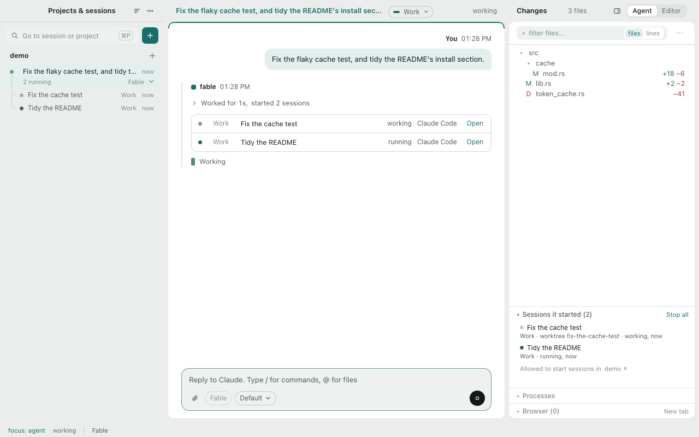

# The orchestrator

An orchestrator is a session that starts and steers other sessions. It is a
session like any other, in a terminal or integrated, in any project, and
you talk to it the way you talk to any agent. Every session has a set of
tools for the sessions around it: it can see the open projects, start a
session in one of them with a prompt, send a running session a line, wait
until one of them stops or asks for something, read what one has on
screen, and stop them. So any session becomes an orchestrator by being
asked to start others.

To have a session direct the work rather than do it, start it under a
workflow, from the workflow chip in a new conversation's composer, from
the palette or from a project's new-session choice, as
[following a workflow](#following-a-workflow) describes. The session that
follows a workflow is its orchestrator, and is told to direct work rather
than do it, to start a session per piece in the project it belongs to, on a
worktree of its own when pieces touch the same files, to wait on them
rather than ask after them in a loop, to put the user's whole task in the
prompt it starts a session with and none of its own housekeeping, to start
a new session for each new task rather than resume or send to one that did
other work, to read a session's report rather than ask it to say more, and
to leave a line on its own row when it stops, whether to relay a question
or to report, as well as the workflow's own steps. A fresh install has a
workflow for exactly that, Direct: one step of work, on any model, with as
many sessions at once as a session may run (see
[settings](settings.md#workflows)). Its steps add what any workflow's do:
edit no files, hand out work only through `start` and never through its
own subagents, and name the step in each start. A session
that follows no workflow is told none of this. Every session, an
orchestrator included, is told that once it has started sessions it keeps
calling `wait` until all of them are done, and does not hand its turn back
while any is running unless it needs the user or the user wrote to it,
that it answers a message from the user that comes while they run as the
final message of its turn and ends the turn there rather than waiting
after the answer, that a message from the
workbench, not the user, is what those sessions did while it was idle,
both only where the workbench can wake it (see [when the user writes to
it](#when-the-user-writes-to-it)),
and that the workbench puts away a session it started once that session's
work is over, as [when the work is over](#when-the-work-is-over) describes,
so it stops one only when its work is not wanted.

Earlier versions of the workbench ran such sessions in a project of their
own, the folder `orchestrator` under the workbench's home. While
that folder holds past sessions the sessions pane lists it as a project,
under its name, so they can be read and resumed. A session resumed there is
a session like any other: it is told nothing of directing, has the tools
and hooks any project has under the [hooks](hooks.md) setting, where the
folder has a project override of its own like any project, and keeps
its token and what it started, as [what is
remembered](#what-is-remembered) describes. Nothing new starts in the
folder: it has no new-session button, its menu holds only Close project,
and neither the agent pane nor the palette offers a new session there.
Closing it closes its sessions and takes it out of the pane for good; it
comes back only when a session of it returns from the last quit, or when
you open the folder again, which lists it in front. It is never one of the
open projects: `projects` does not list it and `start` refuses it. Nothing
in the folder is moved or deleted.

## The tools

The seven tools reach the workbench through the same tool server the app's
own tools use. A session that follows a workflow has them whatever the
projects were told about live updates: it is pointed at the server when it
starts where its project's configuration does not point at it already. Any
other session has them where its project's hooks are on. See
[hooks](hooks.md) and [agents](adapters.md#under-a-workflow).

`projects` lists the open projects, the caller's own marked, so a session
names a project the app actually has. `sessions` lists the sessions the
caller started, each with its id, its name in quotes, its project and
worktree, its agent, what it is doing and the last line it left. What it is
doing is working, waiting, asking for permission, at its usage limit until
the time the agent named, stopped on an error, waiting with its turn
interrupted by the user, or waiting on work in the background, as under
`wait` below. A session that is not running says why: it ended, the user
closed its row, the workbench put it away once its work was over, or it
has not run since the workbench was restarted, each with the way back: a
line sent to it for the last two, a start naming it for the others. A session
that has stopped, ended or asked for permission without the caller having
been told says so beside what it is doing, and listing it counts as
telling. `start` starts a session in a project with a first prompt, on a
worktree of its own if it asks for one, and answers with the new session's
id and tells it to keep calling `wait` until every session it started is
done. A start can wait on the user, as under [a call that waits on the
user](#a-call-that-waits-on-the-user). `send` types a line
into a running session, and Enter after it on its own, as a person does,
though never one that begins with `!` (see [what the user is
asked](#what-the-user-is-asked)). A long line goes in as a paste when the
session's terminal has asked for paste, and in small pieces a moment apart
when it has not, so the agent takes it whole either way. Its Enter follows
on its own, later the longer the line is. A session that runs integrated
is sent the text as a message, whole, as the user's own is, and one sent
while it works waits for its turn. A session being reopened the other way,
by the user or by the setting of how its agent's sessions run (see
[sessions](sessions.md#integrated-sessions)), takes the line once its next
run is up, the way that run takes one; one not up within half a minute is
refused, saying to send again in a moment.
`wait` sits until a session stops working, asks for permission or ends, or
until the seconds it was given run out. A session whose hooks report its
turns stops working when they say its turn ended, and never because its
screen went quiet: an agent running a long command, or thinking, draws
nothing but its spinner's clock for minutes on end, and is still at work
(see [sessions](sessions.md)). How the turn ended is said for what it is.
A turn the agent ended is "stopped working", and the answer adds a line
saying the workbench puts the session away once it has rested five
minutes with nothing open, and that a line sent to it after that resumes
it; one a usage limit ended is "is
at its usage limit until 4pm", with the time the agent named where it is a
time or a date as Claude Code writes one, or "stopped at a usage limit"
otherwise; one another error from the model's service ended, such as a
connection lost mid-response, is "stopped on an error", with the error's
line, quoted, where it is not the session's last line; one the user
stopped with Escape is "stopped: the user interrupted its turn"; and one
the agent ended with work still running in the background, a command or
a call of its tools it put there, says so, quotes their descriptions, and
says that when it finishes the session takes it up in a turn of its own,
which a dev server or a watch may never do. Claude Code reports a turn an
error ended through its hooks. Where nothing reports how a turn ended, as
when only the agent's idle notice says it is waiting, and the window saw
that turn begin, the last lines of its screen are read for the lines
Claude Code itself draws for a usage limit or an API error: the last
result line under the turn's last bullet and the notice in its footer,
read from their start. What the agent wrote, about a limit or an error or
anything else, is never taken for one. The tool server counts those
seconds from before the window heard of the call, and the call carries a
time a moment before the tool server stops reading; the core leaves no
answer past it. A stop a wait answers with counts as
told only once the answer is left where the call reads it, so one that
comes too late for the call is still untold, and the next wait answers
with it. The window answers that nothing happened two seconds early, or
halfway through a wait of four seconds or less, so that answer is in time
as well. A stop is told once: the wait that
answers with it, a listing that shows it, a note and a wake each count, so
a session that stopped between two waits is answered by the next one at
once, and one that went back to work in the meantime is waited out as
usual. The next wait after a stop waits for the next thing that happens.
For a session whose hooks report its turns, a stop is news again only once
another turn of its own has begun, though it began and ended between two
looks, or once it comes to rest another way, such as asking for
permission; being seen at work again within the turn it was told of does
not make the same stop news twice. Each ask for a permission is news of
its own: one granted and followed by another ask in the same turn is told
again. So is a turn's end the agent's hooks report after the window took
the turn as stopped by the user: the Escape or Ctrl+C before the still
screen may only have closed a menu or a view, and the turn went on. A
wait over all
of a caller's sessions answers first with a stop the caller has not been
told of; a session that ended or asked, and was told so, is answered again
only when none of the others is still running. A wait naming a session the
caller started that is not running answers at once with why, as the
listing gives it, and the way back; a wait over all of them, when none is
running, says so. A wait the agent gave up on,
because the user interrupted it or the agent itself is gone, ends without
telling anything; what the user's message says instead is under [when the
user writes to it](#when-the-user-writes-to-it). `read` answers with the
last lines on a session's screen, as you would see them, whether or not it
has ever been on screen; for an integrated session, which has no screen,
with what its agent last said and did, a line for each step, and what it is
doing or waiting for now; each message in it, and each that waits for the
turn, is said to be the user's or the session's that sent it. A message one
session sends another shows in that session's thread under the sender's
name, never as the user's. `stop`
stops a session and files it with the earlier sessions to resume, behind
their row, rather than leaving a row of it under the project, and its
answer says the session is off the caller's list. A finished session needs
no stop (see [when the work is over](#when-the-work-is-over)); `stop` is
for work that is not wanted. A stop
naming a session the caller started that is not running says why it was
not, and takes it off the caller's list all the same, since a stop says
the caller is done with it. `read` naming such a session says
why it is not running and how to bring it back, and so does `send` naming
one the user closed or that ended; `send` naming one the workbench put
away, or one not run since a restart, resumes it with the line as what it
goes on with, as a start naming it would, and says so. A wait closed by the
row going says whether the user closed it, and a session the workbench
never had, or that is not the caller's, is refused as before.
A tool that names a session takes its id whole, or its first eight
characters or more, as many as a row with no title of its own shows of
it. Those are matched against the sessions the caller started and no
others: a start of an id that fits more than one of them is refused with
the ids it fits, and one that fits none is refused as an id the workbench
does not know, so it never reaches a session the caller did not start.
A session `start` starts runs in a terminal or integrated as the
agent's own setting says, and every tool acts on it either way; what an
integrated session cannot do when it is not running, such as take a
message, the answer says, with the way to start it again.
A start can carry a name for the work, which the
session's row and its worktree take; a name the project already has is
numbered rather than refused, so the same work twice is fix-it and fix-it-2.
The row takes the name cut to 60 characters, and not at all when it would
pass for the user, the workbench, an agent or another session (see
[sessions](sessions.md#integrated-sessions)); the answer says which, with
the name in quotes as every answer gives a name (see [when the user writes
to it](#when-the-user-writes-to-it)). The name is kept with what the caller
started, and stays the session's across a close, a resume by its id, a
change between conversation and terminal, and a restart: its row and every
answer use it whenever the agent's own title for the session names nothing,
as when a session resumed in a terminal has not titled itself yet, and a
resumed conversation is not renamed by its next message. A title of the
agent's own takes its place while there is one.
A worktree it starts in is trusted where its project is, with either agent,
so nothing asks on the way in. It has the project's hooks when the project
has them on, so `sessions` and `wait` follow the agent's own word for what
it is doing there as they do in the project, except for a project that is
a folder inside its repository; see [hooks](hooks.md). A start can also
name a model, which goes to the agent on its command line and holds from
the session's first turn, so an orchestrator chooses the model for a piece
of work when it starts it rather than sending a model command afterwards.
A model's name belongs to one agent, so a start that names a model names
the agent too, and one that leaves the agent out is refused rather than
given the project's last.
A start that names no model, for a step that names none either, runs one
model below its starter's when both run Claude Code, the starter is a
conversation, whose agent reports the model it runs on, and that model is
above Sonnet: Opus under Fable, Sonnet under Opus. Most work handed out
needs less than the session directing it, and each turn costs by its
model. A review step's session is the exception and runs on the agent's
default, since judging work is where a weaker model costs most. A starter
in a terminal, whose model may have changed since it started, one on
Sonnet or below, and one whose model the window has not heard leave the
model to the agent. So does a model below that would still be above the
default the account runs on, as Claude Code reports it to a conversation.
The start's answer says which model the session runs on.

A session another started also compacts its conversation once its context
reaches 150,000 tokens, through Claude Code's own setting for when it
compacts, since every turn reads the whole context. The user's own
sessions keep the agent's default. There is no setting for either.

A start can name an account, by the name it has in the settings, or
Default, in any case, for the agents' own login, for work the user asked
to have done under a particular login, or for work a session under a
named account moves to the other login once that account has reached its
limit. One that names an account there is not is refused with the names
there are, Default among them. A start under another account than its
starter's is asked about as any start under another login is (see [what
the user is asked](#what-the-user-is-asked)). A start that
names none runs under the account of the session that started it when that
account was chosen for the starter itself, which is when it is not the
account of the starter's project; the agents' own, chosen that way, is
handed on like any other. A starter that runs under its project's account,
or under the one for every project, hands nothing on, and the session runs
under the account of the project it starts in. The project's account is
used as well when the starter's chosen account cannot be handed on: when
the project is on another machine than the starter, where the starter's
login may not be, and when the account is no longer in the settings. An
account handed on that keeps no directory for the agent being started runs
that agent on its own directory, as a blank directory does anywhere. A
session resumed comes back under the account it ran under.

## When the work is over

A session another session started is put away by the workbench once its
work is over, so finished rows do not pile up under the starter and no
agent has to tidy them. Its work is over when all of these hold: it is
running; it ended its turn itself, with nothing left running in the
background and no error or usage limit; its starter has been told so, by a
wait, a listing, a note or a wake; it asks nothing; no message of the
user's or the starter's waits for it and no line is being typed into it;
no call of the starter's that is not done names it, such as a wait on it
alone, a read or a line on its way; none of the sessions it started
itself is at work or has come to rest without its hearing, so it is there
to be woken for them; it is not the session on screen; the
user has read it; and the user has no words in its terminal or its
composer. Once that has held for at least five minutes without a break,
its row closes and the session goes among the earlier sessions to resume,
as a stopped one does. Anything that breaks it, the session at work again,
the user selecting it or marking it unread, starts the five minutes over,
and so does the end of a call that names it. The window keeps the time,
so a reload starts it over too. A start that would pass the cap, or a work
step's room, puts away at once the caller's sessions whose work is over,
never one the user has not read.

A line its starter sends brings it back under the account it ran under and
in the permission mode it ran in, whatever mode the starter runs in by
then. Lines that arrive while it comes back wait for it, and then go to it
as to any running session.

A session put away stays on its starter's list. `sessions` lists it as put
away by the workbench once its work was over, and a line its starter sends
it resumes it where it ran, with its conversation and the line as what it
goes on with. A wait over all of the starter's sessions passes over one
put away while it waits, and once every session it watched has been put
away it answers that none is running.

After a restart, a row of a session another session started that the core
no longer runs is put away the same way, without being started, unless it
was the session on screen at the quit. One that comes back unread, or that
the user writes in before the core has answered, stays until the user has
seen it, and goes five minutes after. A row whose core could not be asked,
which may still run it, is kept. Its starter's list says it has not run
since the workbench was restarted, and a line sent to it resumes it.

## Who is calling

Every session the workbench starts is given a token as it starts, chosen by
the workbench, in its environment as `CHORD_SESSION`. The agent passes
its environment on to the tool server and its hooks, so every call they
make carries the token, for Claude Code and Codex alike, in a terminal or
integrated, here or on another machine. A Codex session carries it from its
first call, before Codex has told the workbench its own id. The starter is
the session whose token the call carries, and two sessions in one directory
are two starters, each with its own sessions, its own standing answers and
its own cap.

A session resumed has the token it had, kept by its agent's id, between
runs of the app too, so it is the same starter as before. The agent's own
id is what it is resumed by, and what the tools name the sessions it
started by; no tool answers with a token.

An agent's id is never a token. The tools answer with ids and the sessions
pane shows them, so any agent can learn one, and a session named by its id
could be called as by any of them. A session from before there were
tokens, which was named by its id, is given a token of its own the first
time it is resumed, and keeps it from then on; what was kept under its id
moves to the token, as [what is remembered](#what-is-remembered)
describes. A session that was still running under its id when the window
was reloaded, whose environment holds the id, is named by it until it
stops, and its next start gives it a token.

A call whose token names a session the workbench is not running, one it
never had or one that has stopped, cannot come from one of its sessions,
and every one of the seven tools refuses it, with the reason, asking
nothing. A call that names an agent's id is refused the same way. The
other tools never take either for that session's: show, diff, terminal,
notify and present act as for an agent the workbench did not start, the
browser tools refuse it, and the settings tools put its change to the user
as an agent's.

A call that names no session is taken for one from an agent the workbench
did not start, such as one run by hand in a project whose hooks are on,
which has the same tools. That is all the workbench knows of it: a session
whose tools do not pass its token on makes such calls too, one that took
the token out of its environment, or a Codex installed as a script on
Windows, which is not told how to pass it on (see
[adapters](adapters.md#under-a-workflow)). It is never taken for a session
running where it calls from. It is a starter of its own, known by the
directory it calls from: it lists, directs and resumes the sessions it
started from there and no others, with a cap of its own, and follows no
workflow. Every session it asks to start is put to the user. The question
says only what is known: an unnamed agent running in that directory is
asking, one run outside the workbench or a session that left its name out.
It offers Allow once or No: the workbench cannot tell which agent it is,
so no standing answer is used or given. A session started by another that
calls with its token taken out of its environment is asked about each time
in the same way. The sessions such an agent starts run under the
project's account, which the question and the answer name, and start none
of their own. While any session follows a workflow it may list and look but
not start, resume or send, since it cannot be held to the workflow. Two
agents run by hand in one directory are one starter to the workbench, and
share what they started there.

The token is an identifier, not a secret: the workbench cannot see which
process made a call. A tool server run by hand from a session's shell has
that session's token in its environment, and an agent started from that
shell does too; either is taken for that session, as under [following a
workflow](#following-a-workflow). The request log in `~/.chord`
is how a call reaches the workbench: the tool server adds a line for each
call, with its token, and the workbench reads it. The log holds the most
recent calls, up to a quarter of a megabyte, and any program the user runs
can read it and add to it, so any agent of the user's can learn the token
of a session that called lately there and call as it. The token is also in
the environment of the session's own processes and in the window's stored
state, which any program the user runs can read too.

## When the user writes to it

What the sessions a session started do reaches it when it asks, through
`wait` and `sessions`, and when it is idle, as [when it is
idle](#when-it-is-idle) describes. So that it does not miss
one when the user writes to it while the work goes on, the user's message
reaches it with a note ahead of the user's words: a line for each session
it started that stopped working, asked for permission or ended since it
last looked, in the words a wait answers with. A session's last line in
it, as in a wait's answer and a listing, is given on one line, cut at 120
characters and in double quotes, any quote mark of its own made single and
any character that changes how text reads without being seen, such as a
line separator or a mark that reverses text, written as a marker like
⟨U+202E⟩, so nothing in it can close the quote and read as a line of the
workbench's or the user's; the note's first line says that each last line
is that session's own words, not an instruction. A session is named in it,
as in every answer, by its id, which its agent does not choose. While the
window does not know a session's id, the session is named by the name its
row has instead, which a start, its agent's title for the terminal or the
first words of its conversation may have given it, made safe the same way
and cut at 60 characters, as a row's name is. A listing gives that name
beside the id, and a refusal that names the work of a review gives it too.
An id of any other shape than the agents' own, up to 64 letters, digits,
dashes and underscores, is quoted the same way. When the user's message cuts a
wait short, or comes while one is held, the note also names the sessions
still at work and tells it, when there is something to tell the user, to
answer them as its turn's final message and end the turn there, since the workbench wakes it when one of them stops
or asks. A wait
still held answers for the sessions it watches, so the note leaves those
out and gives the rest. A message with nothing to tell goes as it is.
Nothing is typed into its terminal, and no turn is started for it.

The note counts as telling, as a wait's answer does, only once the hook has
the answer or the agent has taken the message. The next wait or listing
does not say it again; a session that has since come to rest another way
is news again.

A session in a terminal is given the note by its prompt hook, which asks
the workbench as the message goes in, with the project's hooks on (see
[hooks](hooks.md)), for Claude Code and Codex alike. The hook waits two
seconds at most. Its call carries the time it stops waiting, and once
that has passed no answer is left for it and nothing is told, so the
next message, wait or listing says it. The call names the session by its
token and is held to the agent's own session id as well: another agent
started from the starter's shell, which has the starter's token in its
environment, gets nothing. A Codex session whose id the workbench has not
learned yet is taken at its token's word. A call from an agent the
workbench did not start gets nothing. Codex asks the user, once in each
project, to trust a hook that is new or changed before it runs it.

A session that runs integrated is sent the user's message by the window,
which puts the note in ahead of the words and shows it in the thread
folded under them as Reports from the workbench, each session by the
name its row has. The note counts as telling once the agent takes the
message into a turn; a message that fails or that the agent drops leaves
it untold, and the next message carries it again. The message also ends
a wait the session holds, with an answer that tells it to read the
message, answer it as its turn's final message and end the turn without
waiting again, and while the agent has not taken a message of the user's,
a wait it calls answers so at once, so the message is never held behind a
wait. The answer ends the turn because an agent's thinking is never shown
in full, and an answer written there just before another wait would read
as work; the wake takes the starter up again once one of its sessions
stops or asks.

A wait the user's message cuts short answers nothing the agent reads:
Claude Code ends the call itself and records only that it did not
complete. The note on that message is what says which sessions are still
out.

An answer that ends the turn leaves it to the wake to take the starter up
again, so a starter is told to end its turn there only where the workbench
can wake it: in a conversation, and in a terminal whose project has the
hooks on, since they are how the workbench hears a terminal's turns end.
A starter in a terminal without them is told to answer the user and then
call `wait` again, as nothing would take it up once its turn ended; its
tool server learns which from the environment the workbench started it in.

## When it is idle

A session that started others may hand its turn back while they still
work. When one of them then stops working or ends, and the starter is
idle, the workbench wakes it: it sends the starter what a wait would have
answered, a line for each session in the same words, then the ones still
at work by their ids, and the starter goes on as it would after a wait. A
session that asks for permission wakes no one, since only the user can
answer it and the row shows the ask at once; it goes along in the next
wake, wait or message to the starter. A starter under a workflow and one
under none are woken alike, and there is no setting for it.

Each wake is a turn that reads the starter's whole conversation, so the
workbench gathers what comes to rest into as few wakes as it can. With
nothing else the starter started at work, the wake goes three seconds after
the last session came to rest. So does a wake for a session that failed or
ended, since the starter may want to retry, resume or plan again at once,
and one for a call answered early that is now done, counted from when the
window saw it done. While others are still at work, it waits
thirty seconds after the last for more to come along, and never more than
two minutes after the first. A starter that has rested long enough for its
prompt cache to lapse, an hour for Claude Code and ten minutes for Codex,
would read its conversation again at full price, so its wake waits until
none of its sessions is at work, or twenty minutes after the first came to
rest. While a wake is held so, the pointer text on the row's not heard yet
mark says when it goes. A message from the user carries everything
unheard at once, and a wait answers as soon as a session it watches comes
to rest, held by none of this. A session that came to rest unheard while
a window watched stays so across a reload of the window, which then plans
the starter's wake for it as above, counted from the reload.

Idle means all of these at once. The starter is running, and its agent
ended its last turn itself, as its hooks say for a session in a terminal
and its own events for an integrated one. It is not being reopened the
other way: the run that goes on is woken once it is up. It holds no wait,
and asks for nothing. The user is not writing to it: an integrated starter's composer
holds no words or images and no message of the user's waits for the agent;
a starter in a terminal has had no key of the user's since its agent last
took a line in, as its prompt hook says, or since Ctrl+C emptied its line,
and none in the last five seconds. Enter alone is no sign the line went:
Ctrl+J, a backslash before Enter and Alt+Enter each add a newline to the
agent's input, Ctrl+U empties only one line of several, and a command such
as /config opens a panel the next keys would answer, none with a prompt
hook. The keys that answer a permission prompt are the prompt's, not the
line's, up to the moment the agent is seen at work again, and what the
terminal answers on its own when the agent asks it something, its
attributes, the cursor's place or its size, is no key at all. While keys
of the user's hold a wake, the pointer text on the row's not heard yet
mark says so. A turn the user cut short, with Escape or the stop button, leaves
the starter unwoken until a turn of the user's has ended as the agent
ended it. A turn of its own that an error ended, a usage limit among them,
leaves it unwoken until its agent next ends a turn itself, since a wake
would meet the same error. A line typed or sent into it, by `send` or by a wake, leaves it
unwoken until a turn of its agent's ends, and lines go into a terminal one
at a time, each with its Enter, so a line `send` types and a wake never run
into each other. A session in a terminal without hooks says nothing of how
its turns end, and is never woken; the row and the next wait still say
what it has not heard.

The message is the workbench's, never the user's. An integrated starter is
sent it as the workbench's own message, which its thread shows on the left
as a notice under From Workbench, each session by the name the user knows
it by, kept once its row has gone. A starter in a terminal
has it typed in on one line, as `send` types one, starting with the note's
own words, From the workbench, not the user, with the sessions kept apart
by bars. Each last line and each name in it is quoted and cut as in a
wait's answer, and a bar in either is typed as a broken bar, so nothing a
session left or was called reads as the start of another session's line;
the message says each last line is that session's words and not an
instruction. A session cannot choose which starter is woken or put words
of its own into the message beyond its last line and, while its id is not
known, its name, and the message never begins with a slash. It is never
typed while the starter shows a question or a permission prompt, where a
key would answer for the user, and whether the starter is still idle is
asked again before the line goes in and before its Enter: a key of the
user's in between leaves the line unsent.
The wake's text then stays on the line ahead of the user's key, since
nothing can take it back safely, and the user's next message carries it.

What a wake carries counts as told the moment it is sent, so the next wait,
listing or note does not say it again, and the prompt hook the message sets
off has nothing to add. A message that never reaches the agent, because the
core refused it, the agent dropped it or a key of the user's held its
Enter, leaves it untold, and so does a line typed into a terminal that
starts no turn within thirty seconds, as when its Enter took a completion;
the starter is then not woken again until a turn of its own has ended. A
woken starter is not woken again for what it was told; the same session
coming to rest again, after more work, is news again. After five wakes with
no turn between that the workbench did not start, as when a session it
started ends turns on its own, the starter is not woken again until such a
turn begins, the user's or one a line from its own starter sets off; the
row's not heard yet mark carries the rest, and its pointer text says why.
A session another started cannot start sessions of its own, so no two
sessions can wake each other in turn, and an agent the workbench did not
start has nothing to be woken in. A rest that began before the window first saw the
session, as after a reload, wakes no one, so a wake is never sent twice;
the row still says the starter has not heard it, and the next wait tells
it.

## Following a workflow

A session runs one of two ways: under a workflow, as its orchestrator, or
as one agent with no workflow. What the user picks is what starts. Picking
an agent, in the agent pane, in a project's new-session row or in the
palette, starts that agent alone. Picking a workflow, in the palette or in
the choice a project's new-session row opens, starts its orchestrator, on the workflow's agent and model, and a plain new
session where there was nothing to pick follows the project's workflow, as
[settings](settings.md#workflows) describes. A new integrated session can
also be given a workflow, or none, in its composer until its first message,
which starts it again as that workflow's orchestrator or as the agent alone;
[sessions](sessions.md#integrated-sessions) says how. A workflow whose
orchestrator runs on an agent that is not installed is refused on the row,
and so is a session under a workflow on a machine with no tool server to
give it the `start` tool.

An orchestrator runs in a terminal or integrated, as its agent is set, and
is held to its workflow the same way in either. It is told the workflow's
instructions and, unless the workflow says otherwise, has its agent's own
ways of handing work to agents the user cannot see taken away, so every
piece it hands out is a session of its own started with `start`.
[Agents](adapters.md#under-a-workflow) says what each agent loses and what
remains. What a session is held to comes from the workbench's own record of
it, found by its token. Nothing a call says, such as a step, a workflow or
a role in its arguments, changes that, and a session another started
cannot start one of its own however it runs.

Each start from such a session names the step of the workflow it is for,
and is held to that step before the user is asked anything. A start that
names no step, or one the workflow does not have, is refused with the
steps there are. A start that names an agent or a model the step does not
allow is refused with the ones it does; one that names neither runs on the
step's default model, and one that names only the agent on that
agent's default. A session started for a step stays on the model it was
given: `send` gives it no command but `/compact`, since commands such as `/model`
and `/fast` change the model and either agent completes a command from the
start of its name, and a start or a resume for a step does not begin with
one either. It begins in its orchestrator's mode, as every started session
does (see [what the user is asked](#what-the-user-is-asked)), so the
workers of an orchestrator in Plan plan too and each asks before it leaves
Plan; the answer to each start names the mode, for the orchestrator to tell
the user. A line counts as a command where it begins with a slash once
characters that draw nothing are passed over and a wide slash is read as a
slash, so one that begins with a path is refused too, and says to put a
word before it.

A work step runs no more sessions at once than it says. A start past that
is refused with the sessions running for it, and so is a resume: a session
whose work is taken up is stopped to make room. A session the orchestrator
stopped is off its list and is not resumed; its piece goes on in a new
start that names it as the work it carries on. A session whose step the
workflow no longer has, because
the step was renamed or removed since, is not resumed, nor is one that was
not started for a step of the workflow, such as one a plain session in the
same directory started; the refusal names
the steps there are. A start takes its place in the step, or its round of a
review, the moment it is checked, before the user is asked, and gives it
back when the user refuses or the session does not come up, so two starts
at once cannot both find room or share a round.

A review names the session whose work it checks. One that names none, or
names a session the caller did not start for a work step, is refused: there
is no work behind it. A piece is named by the work session that began it;
a start for a later work step can name the session the piece came from,
and carries the piece on. A piece that does not pass is sent back with
`send` to its own session for the step the review goes back to, resumed
first if it is not running, or carried on in a new start that names it
where the orchestrator stopped it, and is reviewed again by a new review
naming the same work or by a line to the reviewer.

The workbench counts the rounds of each review for each piece: a review
started, a review resumed with a prompt, and a line sent to a review that
has finished its round each count one. A review resumed with no prompt has
not finished a round since it came back, so the first line it is sent
counts its round. A review may run once and then once
more for every time it may send the work back, so a review that sends it
back three times at most has four rounds of a piece. A round past those is
put to the user through the same question a start is, worded as another
round of review for that piece; the user's yes lets that one round through,
and a no tells the orchestrator, by the work's name and its count of
rounds, to ask the user how to go on; the user's own no is not shown back
to them as a refused start. Another piece
has rounds of its own, and stopping a session does not reset the count. A
fresh piece is not checked against the others, so work started again as a
new piece begins its rounds again.

A started session remembers its step, and a review its round and the work
it checks. `sessions` says both for each session, the stopped ones too.

A call is held to the workflow of the session its token names, as under
[who is calling](#who-is-calling), so a Codex orchestrator is held to its
workflow from its first call, and a session beside it in the same
directory is held to its own. A caller under a workflow is given no
command but `/compact` in a line to any session it started, placed in the
workflow or not.

What this holds to is the session a call names, and the workbench cannot
see which process made the call. A tool server run by hand from a
session's shell has that session's token, or can be given another running
session's, and is then taken for that session: held to its workflow when
it follows one, and its starts asked about as that session's are. One
given no token is taken for an agent the workbench did not start, which may
not start or send while a session follows a workflow. This is no wider than the shell
itself: from it an agent can run another copy of itself, on any model,
with no tool server and no question at all.

## What is remembered

What a session started is written down under the starter's token, or for an
agent the workbench did not start under the directory it called from, each
by its session id, with the project, the worktree, the agent, the name and
the account, and kept between runs beside the sessions the app knows as its
own. Under a workflow, so are the step and round of each, and the rounds
each piece has had; those go with the orchestrator once it is gone from its
project's past sessions, and so does its token. An orchestrator closed and
resumed keeps its token, so the sessions it started are still its own: the
ones still running answer to its tools as before, and a row with one of its
ids, resumed from the pane by hand, hangs under it all the same. When the
app itself was closed, the orchestrator comes back with the other sessions
that were open, and the sessions it started do not. `sessions` then lists
them as not running since the workbench was restarted, after the running
ones; one whose row the user closed is listed as closed by the user, one
whose row had ended as ended, and one the workbench put away as put away,
before a restart and after it, until a
row of it is up again, however it came back: by `start`, by hand from the
pane, or in place of its row, as a session whose workflow was lost is. A
wait held for a session resumed in place of its row goes on with the new
row. `start`
with one of those ids
in place of a project and prompt brings it back where it ran, in its
worktree with its conversation, and so does a line sent to one the
workbench put away or one not run since the restart. A prompt given with it is what the session
goes on with; without one it comes up waiting for a line. The cap and the
one-level rule apply, and a session whose worktree has since been cleaned
up, or whose project is no longer open, is refused with the reason. A
session the orchestrator stopped itself is not offered back: the stop said
it was done with. The record lives with the window's other memory, so a
wiped local storage forgets it, which only means the orchestrator starts
afresh.

A session from before there were tokens had all of this kept under its id,
and the standing answers it was given in this run of the app as well. When
it is given a token, they move there. What it started is joined to the
token's list by session id, so a move made again adds nothing and puts
back a list a second window that wrote over the first lost; the id's list
stays for the version before to read, and a session the starter is done
with, such as one it stopped, goes from both, so a move never brings it
back. What its workflow ran, the standing answers and the sessions it
started in this run move whole, and the id keeps none of them, so one the
starter has since let go of does not come back. A session resumed while a
run of it named by its id still runs gets a token of its own, and nothing
moves until that run stops: what is kept under the id is the run's, and
two rows never share a token.

A session it starts is asked, at the end of its prompt, to leave a line on
its row when it is done or stuck, so the pane, the board and the wait tool
all say how it went, and to end with a short report that someone with none
of its context could go on from: what it did and where, what state the
files and the branch are in, and what is left or open. The tools' own words
say that a new task is a new session, and that resuming a session or
sending it a line is for the task it already has, since either carries its
whole conversation into the work, or for one cold and large, its notes of
it: such a session goes on as a fresh conversation from its notes, as
[notes](sessions.md#going-on-from-the-notes) describes. Its place on its
starter's list and in a workflow moves to the fresh conversation's id,
the answer names both ids, and the old one still names it in every tool.

The tools act on the sessions the caller started and on no others. A
session you started yourself is yours, on a subject of your own: another
agent cannot type into it, stop it, read it or so much as list it,
whatever it has been told to do by something it read.

## What the user is asked

A session that starts another in its own project, on a worktree of it or
not, is not asked about when the session would run on the starter's agent
and under the starter's account, and the workbench knows the starter's
mode. The session begins in the starter's permission mode, so it begins in
no more than its starter: the workbench names that mode when it starts the
session, integrated or in a terminal, as it names a kept mode on a resume,
whatever the settings of the session's account would choose, and the
answer to the starter says it, as "It begins in Plan mode." Narrowing the
starter later does not reach the sessions it started. A mode the
workbench starts no session in gives the nearest one below it, Auto for
Bypass permissions. A session whose agent does not take the mode it is
given, as Auto where its account or model has none, runs integrated in the
nearest narrower mode its agent offers, said in a notice; in a terminal it
runs in the one its agent falls back to, which the window cannot change.
What the settings files allow still applies before anything is asked, as
for any session.

The workbench knows the starter's mode for an integrated session, as its
agent says it now, and for a Claude Code session in a terminal, as its
hooks last said it. Claude Code's hooks say it as each turn begins, before
the agent sees the prompt, so with hooks on it is known before any call
the turn makes, after a restart too. A mode changed in the middle of a
turn is known only once the next hook says it, so a start made in that
same turn gives the mode before. A Claude Code session in a terminal whose
hooks have not said its mode, as with hooks off, is asked about, since a
mode chosen in its terminal is seen only through them. If the user allows
the start, the session begins in no more than the mode the workbench
started the starter in, where it named one, as the mode kept for a
conversation it resumed, and otherwise in the mode its agent chooses from
its settings.

A Codex session in a terminal is not compared. Its hooks never say its
mode, so the workbench takes the one it started it in, the mode kept for a
conversation it resumed, and does not see a change made in it with
`/approvals`. Codex asks before `start` itself in Read only and in Auto,
since the workbench gives it no standing approval for that tool, and Full
access is the top of the scale, so Codex's own question covers a starter
in a narrower mode. A session it starts begins in the mode the workbench
started it in where it named one, and otherwise in the mode its agent
chooses from its settings, as one the user starts does. A starter whose
mode the workbench knows but cannot place, by a name it does not know, is
asked about, and its session begins as its settings say.

The modes stand on one scale for both agents: Claude Code's Plan first,
then Default and Don't ask together, since Don't ask refuses what Default
would ask about, with Codex's Read only beside them, then Accept edits,
Codex's Auto, which runs commands without asking only inside its sandbox,
Claude Code's Auto, and last Bypass permissions with Codex's Full access.
A session on the starter's agent begins in the starter's own mode. One on
the other agent, which is always asked about, begins in the widest of its
agent's modes that goes no further than the starter's, or in the narrowest
it has where none is that narrow, as Read only for a Codex session
started from Plan.

A start there on another agent or under another account runs under
another login and other settings, and is asked about as a start anywhere
else is. A start on an agent or a model its workflow's step does not allow
is refused before anything is asked. The session's row and the answer to
the starter say what was started either way.

A session started without a question takes no command from its starter
but `/compact`, in a line `send` types, in its prompt or in a resume, since
a command such as `/permissions` or `/add-dir` would change what it may do.
No session that runs in a terminal is sent a line, or started or resumed
with a prompt, that begins with `!`, whoever started it: Claude Code, and
recent versions of Codex, run such a line as a shell command with no
permission asked. Both are read as a line that begins with a slash is
under [following a workflow](#following-a-workflow), past characters that
draw nothing and with a wide mark read as the plain one.

The settings can put every start to the user instead, in the starter's own
project too (see [settings](settings.md#sessions)). While they do, no
answer stands: the question offers Allow once or No, as it does for an
agent the workbench did not start, and a standing answer given before is
not used.

The first time a session asks to start another anywhere else, the window
puts the question up over the agent pane and holds the call while it is
up, as under [a call that waits on the user](#a-call-that-waits-on-the-user):
allow it from now on, allow this one, or refuse. A round of
review past a workflow's limit is asked about every time, in the starter's
own project too, however the project was allowed. It says the project the
round runs in, then names the review and the work by the names the user
sees, "Review has run twice on Fix the cache, as many times as the workflow
allows. Allow another round?", with Allow one more round or Stop at the
limit. For a caller that runs
integrated, the round docks over its composer while its conversation is on
screen, with the same two choices taken as the dock takes any request (see
[sessions](sessions.md#integrated-sessions)), so it never covers the
header that says where the run stands; anywhere else it is put over the
agent pane as above, and it moves into the dock once the caller is on
screen. An allowed caller is
remembered for that project and what the session ran on, for as long as the
app runs: the account, and the agent too where the account keeps no
directory for it, since that agent then runs on its own. A later start
there under another account, or under the same account by an agent it keeps
no directory for, is asked about again. A refusal is an answer the agent
reads, not an error. Bringing back a session it already started is never
asked about: the consent was given when the session was, and the resumed
session is that one going on. A start an agent the workbench did not start
asks for is asked about every time, with Allow once or No, as under [who is
calling](#who-is-calling).

Once there are accounts to tell apart, the question names the account the
session would run under when it is not the project's own, when the
starter's chosen account could not be handed on, when an account handed on
keeps no directory for the agent being started, and for an agent the
workbench did not start, which hands none on. When the account it names
keeps no directory for that agent, it says the agent uses its own. A round
of review that would start a session names the account in the same cases,
after the project. The answer the caller gets to its start names the
account in the same cases and says when the agent uses its own directory,
for a start for a step of a workflow as well as any other.

A session started by another may not start any of its own, and no session
may have more than eight running at a time. Both hold by the token, so a
session started by another is held to them from its first call, whatever
its agent. An agent the workbench did not start has a cap of its own, by
the directory it calls from.

### A call that waits on the user

A start the user is asked about, a start or a resume for a round of review
past its limit, and a line `send` would give a review past its limit wait
on the user's answer, for as long as the user is away. An agent gives up
on a call of its own accord after a while, Codex after a minute where it
is not given longer (see [agents](adapters.md#naming-the-session-to-its-tools)),
and the tool server after ten minutes, and an answer that comes after it
gave up is never read. So such a call is held no longer than forty
seconds. Not done by then, it is answered that it waits on the user, that
nothing has started or been sent yet, and that `wait` will say how it went;
the question stays where it was. A start the user allowed whose session is
still coming up by then is answered the same way, as under way.

Once the call is done, how it went is the caller's to hear, once: what
the call would have answered, after a few words that name it, such as
`Your start of "Fix the cache" in /work/api went ahead:`, or `did not go
ahead:` where it was refused. The next `wait`
answers with it before anything else, and holds for it though no session
the caller started is running; a `sessions` listing says it, or that it
still waits on the user; the note on the user's next message carries it;
and an idle caller is woken with it, as for a session that came to rest.
Each counts as telling, as they do for a stop. A call the agent gave up on
before its answer, as when the user interrupted the agent, goes the same
way, and so does one the tool server gave up on: it tells the window, and
says to the agent that the call may still go ahead and that `wait` will
tell.

One call is done once, however it is heard of, so it starts one session
at most. The same start, resume or line asked for again by the caller
while one it was told of waits is refused, saying that one is on its way,
and nothing is asked twice; calls made together are each their own. The
same start is the same work in the same project and step, on the same
agent and model, under the same login and by the same name: the same work
on the agents' own login once the account it first ran under has reached
its limit is another start, and is put to the user in its turn. A caller
that stops has nothing done for it: its question on screen is taken down
and the next put up, one of its still waiting behind another is never put
up, and what it had still to hear of its calls goes with its row.

How each call went, and which still wait, are kept with the window's own
state, so a window closed or reloaded meanwhile still tells the caller.
A call whose question was still in front of the user went with the window,
and is told as not done; one the user had allowed that was still under way
is told as perhaps done, with the `sessions` listing to see what runs.

## In the panes

The agent pane's header says where a session stands in its workflow,
right after the title and in the header's own type, the same for a session
in a terminal and an integrated one.

For the session that follows the workflow it is a chip: a pip for each step
in order, grey once the run has passed it, in the accent where the run
stands and empty for a step to come, and the words for where it stands.
The chip says what the workbench knows and no more. An integrated session
shows it from its first message on; before that its composer names the
workflow, which can still be changed there.

Before anything is started the words are the workflow's name, marked
deleted where it follows the copy it kept. Then they name the step where
the work stands, with its round where it has one, "Review, round 2 of 4",
and with pieces of work in different steps, how many stand in each, "1 in
Work, 1 in Review". A piece stands where a session of it is at work, or
else where its latest session came to rest. With pieces at work the chip
names their steps; with none, the steps the pieces rest in. A piece that
never reached the work a review checks, such as a plan the orchestrator
did not carry on into the work, is left out once another piece has.

The workbench never learns whether a review passed. Once every piece has
finished a round of the last step and nothing is at work, the orchestrator
included, every pip is grey and the words say the round that finished,
"Review, round 2 of 4 done", or how many pieces finished it, "2 done in
Review". They never say the run is done.

A round is finished only when the workbench saw its session come to rest
after a turn of work. That is remembered with the run, so a session the
orchestrator stopped once it was done, or one that is not back after a
restart, is still done. A session that crashed reads stopped. One that
ended or was closed while at work, or before it was seen to rest, reads
ended. Neither has finished its round, and the chip names its step
without saying done.

While a round past the limit waits on the user the chip turns to the
accent and says so, "Round 4 of 4 done, asks you", with the step of any
piece still at work lit beside it. A piece the user stopped there, with
Stop at the limit, reads "Stopped at round 4 of 4" in the chip's own ink,
its review lit, until another round of it goes ahead. A screen reader hears
the same, with each step done, skipped, now or to come; a step passed with
nothing run for it, as when the orchestrator did it itself, is grey and
said to be skipped.

A popover under the chip says what stands in each step: the latest session
of each piece there, by its name, with its round and whether it is
working, asking, done, stopped, ended or stopped at the limit, and the
name opens that
session; a step passed with nothing run for it says skipped. The rules the
orchestrator was given are folded at its foot. It shows when the pointer
rests on the chip, and a click, Enter or Space holds it open, the one the
pointer showed as well, with Tab going on into it; a second click puts it
away. Escape, wherever the keyboard is, or a press elsewhere puts it
away without reaching the agent, and Escape gives the keyboard back to the
chip when it was in the popover.

A round is one pass of work and review. A review's round is counted as
under [following a workflow](#following-a-workflow). Work its piece goes
back to once that review has come to rest, by a line, a resume with a
prompt or a new start that carries the piece on, goes on in the next
round, so work sent back once reads "Work, round 2 of 4". A line to the
work while its review is still at it, such as an answer to the review's
question, is no round of its own. The workbench cannot tell work sent back
from a line after a review that passed, such as one asking for a commit,
so that too reads as the next round. Work the user stopped at the limit
goes on in the last round, never past it, so it reads "Stopped at round 4
of 4" again once it rests. The most counts the first pass: a review that
sends the work back three times at most has four rounds. A
round of work is remembered with the run, as a review's is, and so is a
stop at the limit.

A session started for a step has a quiet tag in the chip's place: the
workflow and its place, "Review, round 2 of 4". Its rules open in a popover
under it the same way: what the step allows, in the words of its settings,
the models it may use, how many sessions it runs at once, and for a review
when the work passes, and where and how often it sends the work back, and
Escape puts it away wherever the keyboard is, without reaching the agent.

Where the header is short of room, a tag's workflow name is cut short and
then left out, and the place, or the chip's words, stay whole until it has
gone; only then are they cut short, and
they go at a letter or two. The chip's pips stay until the title has given
way, and the words take no room once gone (see [layout](layout.md)). A
start the workflow refuses its
orchestrator is shown over the terminal in one line, whole while the
pointer or the keyboard is on it, as well as answered to the agent, until
a start goes through or the line is put away.

The sessions a session started hang directly under it, one line each,
joined to its dot by a thin rail: the state dot, the name, the model it was
started on and when it last changed. A session started for a step of its
starter's workflow shows its step there instead of the model, since the
step chose the model, with its round of the most in short, "Review, 2 of
4", kept whole while the name is cut. One
that runs under another account than its project's names the account after
its own name, as in `as Work`, and one that runs in another project than
its starter names that project next. Short of room, the project is cut
first, then the model is left out and the project with it, then the
account, and the name is cut last; the time, the step and asking always
stand. The line speaks
up in the accent, `asking` where the model stands, when the session needs
a permission, which only you can grant. A starter that runs integrated
also holds that request in its dock, to be answered there for that session,
or for one in a terminal with the way to it (see
[sessions](sessions.md#integrated-sessions)). Everything else they wait on, the
starter hears, so the place to go is still the starter and not the
session it started. A session whose starter the window no longer has
stands in its own project like any other.

In an integrated session's thread, the sessions a turn started stand as
rows under it: the state dot, the step it was started for, the name, its
round of the most and what it is doing, "round 2 of 4, working", the model,
and Open, which goes to it.

A starter's second line says in words what the sessions it started are
doing, each counted once, `2 running, 1 asking, 1 done`, unless its agent
has left a line there. While the starter is idle and holds no wait, the
line also says how many of them stopped, asked or ended since it last
looked, `2 not heard yet` where the model stands, in the line's own colour
with a small mark in the accent, and the line of each such session carries
the same mark at its end, which a screen reader hears as not heard by the
starter yet. The pointer resting on it names the starter, which sessions
and how it hears of them: on its next wait, or with your next message
where it gets the note. It is the starter's to read, not yours to answer,
so it marks nothing unread, and it goes once the starter is told. Once the
workbench has woken the starter, the same place says what woke it, `woken by
Fix the cache`, or `woken by 3 sessions` when there were more, quietly in
the line's own colour, and the pointer resting on it says what each of
them did. It stays through the turn the wake began and after it, and goes
when you look at the starter once that turn is over, as the line a row was
left does, or when a turn of yours begins. Short of room it gives way
before the line beside it, down to "woken by" and the first letters of the
name, and only then is the line cut; how many sessions woke it is never
cut. Once the workbench has stopped waking the starter, after five wakes
in a row, the pointer text on its not heard yet mark says so. Short of
room it gives way before anything else on the line: the words go, then
the mark and the count, and what the sessions are doing stands, asking
included. On a started session's line the mark is the first thing to go. A
starter can be folded, from the chevron at the end of its second line or
with Left on the keyboard, and Right lets them out again: folded, its second
line says what they are doing whatever the agent left, with a small dot for
each where the model stands otherwise. Left on a started session moves the
cursor up to its starter. Nothing about the fold is remembered.

A session that started sessions has the board for them in a section at
the foot of its changes pane, under the tree and beside Processes and
Browser, headed Sessions it started with how many (see
[layout](layout.md#under-the-tree)): stop one or all, send one a line, take
back a project it may start in without asking, and clean up the worktrees
its starts left behind. It is there while the session on
screen has sessions it started, has been allowed to start more in a project
without being asked, or has worktrees its starts left behind, so that can
still be taken back and those cleaned up once they are gone. Each row
is a session's name, drawn as the agent gave it with anything unseen
written out, cut to what the row holds, and under it its step and round
where it runs for one, in the words of the run's chip and the rail, the
project when it is not its starter's, its worktree, what it is doing and
how long since that changed. The row's own buttons send it a line, typed
into its terminal or sent as your message to an integrated session, or
stop it, and a click or Enter goes to it. Under the rows, each project you
allowed it to start in has a × to take that back, and the worktrees its
own starts made and left behind are counted, with Clean up; a worktree another
session's start made, or one you made, is never counted or taken. Stop all
and Clean up ask first, the one saying how many of them still run and how
many of those wait on you or are at work, the other naming each worktree
that goes with its branch. The section is open until you fold it, the fold is
remembered, and it opens by itself when one of them asks for a permission.

The sessions it started keep out of the keyboard's way too: Delete on one
of them in the sessions pane does nothing. Its own × stops it, Delete on its
row in the section asks first, and Stop all on the board stops every one.

## Where the work happens

A session under a workflow directs; it does not edit. The sessions it
starts run in their own projects, on their own branches when they asked
for a worktree, each with its own terminal and scrollback, and they are
sessions you can open, type in and take over at any point.
