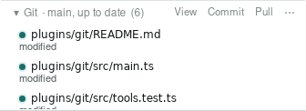

# Plugins

A plugin adds to the workbench from outside it: tools for the agent, a
section under the file tree with rows and actions, and a view in the
changes pane. It comes from a git repository, runs on the machine the
project is on with the user's own privileges, and produces data the app
draws in its own hand. Nothing a plugin does reaches the window's DOM.

## Where plugins come from

A source is a git repository, with a ref, or a directory on the machine
for one being written. A source holds any number of plugins, named in one
manifest at its root, `workbench-plugins.toml`, the way a compose file
names its services:

```toml
[[plugin]]
name = "github"
path = "github"
description = "Pull requests, checks and review comments for the branch."
version = "0.2.0"
run = ["node", "dist/main.js"]
build = ["npm", "run", "build"]
tools = ["pr", "checks"]
sections = ["Pull request"]
view = "wide"

[[plugin]]
name = "git"
path = "git"
description = "Commit, stash, pull, push and a graph of the branch."
version = "0.1.0"
run = ["node", "main.js"]
tools = ["commit"]
sections = ["Git"]
view = "full"
```

Each plugin has a name, which is its identity everywhere, a path to its
directory under the source, a line of description, a version, and the
command that runs it: a runtime found on the login shell's PATH, `node`
above all, with a script, or a binary per platform. A plugin whose script
is made rather than kept in the repository names the command that makes it
as well, run where the plugin is and before the process starts; fetching
what that command needs is the command's own business. What the plugin
declares, tools, sections, a view and how much room the view wants, is
listed so the settings can say what enabling it means before it has run.

Sources are added in the settings, by URL or by path. Adding one clones
it, pins the commit that was cloned, validates the manifest, and lists its
plugins, every one of them off. Validation reads the manifest, checks that
every path stays under the source, that the runtime the plugin runs on is
on the login shell's PATH, that the program its build runs is there too,
that every declared name is a plain identifier, and that no plugin in any
source has the name of another. A plugin with a build is not asked for its
script at this point, since the build is what writes it. A source that
fails says why on its row, "needs node", "manifest invalid at line 12",
"could not clone", and adds nothing.

Enabling a plugin shows what it declares once more, "two tools, one
section, a wide view, runs node", and that it runs with your privileges,
and asks once. Enabling is per install: every project, every machine.

A source stays at its pinned commit. The app checks each source for a
newer commit once a day while it runs and on request from the settings,
and marks the row; updating is a choice made per source, never made for
you. Removing a source stops and removes its plugins.

The workbench knows some sources already and offers them from the first
launch, from a list that ships with it in a file at the repository root.
The list carries each source's repository and ref, and the name and one
line for each plugin the source holds, so the settings can name a plugin
before anything has been fetched. Every plugin is off and nothing is
cloned until one is turned on. Turning one on asks what any other plugin
is asked, where it comes from and that it runs with your privileges, and
agreeing fetches the source with git, pins the commit, and starts the
plugin. Once fetched, a source the workbench knows is checked, updated
and removed like any other; removing it takes the clone away and leaves
the source offered again.

### Joining the known list

The file holds one entry per source: an id, the repository to clone and
the ref to clone it at, and the name and a line of description for each
plugin, taken from the source's manifest in the words it uses. A pull
request that adds an entry is how a source joins the list. The build
reads the file and fails on an entry that is missing anything, whose id
is not a plain identifier, or that names a plugin twice, so a list the
app cannot use never ships.

What a reviewer looks at is the source itself: that its manifest
validates, that each plugin does what its line says it does, and that no
plugin is named as one in another listed source is. A listed plugin runs
with the user's privileges like any other, so being on the list is the
project's word that someone looked, and nothing more.

## How a plugin runs

The core owns plugin processes, the app's own core for projects here and
the daemon's for a project on another machine, so a plugin is where the
project is and the window only draws. A plugin runs as one process per
machine, started when it is turned on and when the app comes up, and
stopped when it is turned off. A process that dies is started again, with
a growing pause between tries; its sections and its page go while it is
away, and the settings row says what happened to it, with the last line it
wrote to its error output when it left one. One that dies five times in a
row before greeting the app is broken rather than unlucky, and is left
alone until it is turned off and on again.

A plugin that declares a build is built before its process starts: the
first time it is turned on, and again when its source is updated to a
newer commit. The build runs where the plugin is, with your environment,
and the settings row says "building" while it goes. A build that fails
leaves the plugin failed, with the last line it wrote on the row, and
nothing is started. Turning a plugin off and on again builds nothing a
second time. A source that is a directory has no commit to remember a
build by, so a plugin in one is built every time it starts.

The process speaks JSON lines over its standard input and output, the
same shape the daemon speaks. It is told about every open project on the
machine and every session in them, and every message about a project
names the project, so one process serves them all.

From the app to the plugin: a greeting with the app's version and the
projects open; a project opened or closed; a session started or ended;
the tree moved; a shell command a session ran, for a plugin that asked to
hear it; an action taken, with its row, any input given and the session
whose section it is on; a tool called, with its arguments and the session that
called it, by the agent's own id as the session events give it, or none
where that is not known yet; a message from the plugin's view; a request
to stop.

From the plugin to the app: a greeting with its name and version and the
full shape of what the manifest declared, the tools with their
descriptions and input schemas, the sections with their actions, the view
with its width; a section's rows for a project, with its title, its line
of detail and whether it starts folded, sent whenever they change, for the
project or for one session in it; a mark on a session's row; a web
address to open in the user's browser; the result of a tool call or an
action; a place to open in the viewer, a
file's diff, files to present, or a line for a session's row, the same
means the agent has; the view's page and the data the view shows. The app
never polls a plugin, and a plugin that has nothing to say stays silent.
A line for a session's row names the session by the agent's own id, as the
session events give it, and the app puts it on the row of the running
session it started with that id. A line naming an id the session events
have not given, one it is not running, or one two running sessions share,
lands on no row.

A plugin gets the project path, the session events, the tree events and
the commands it asked to hear, and nothing else from the app. What it knows about the repository it finds
out itself, `git` and `gh` on the machine, as the agent does.

## What a plugin looks like

The manifest names the tools, sections and view; it holds no code for
them. The `run` command is the plugin's one entry point, started in the
plugin's own directory, and everything named in the manifest arrives at
that process as a message with the name in it. A tool call is one line on
stdin:

```json
{
  "type": "tool",
  "id": "c1",
  "name": "pr",
  "arguments": {},
  "project": "/srv/orbit-api",
  "session": "6f2a…"
}
```

and the plugin's answer is one line on stdout with the same id:

```json
{
  "type": "result",
  "id": "c1",
  "content": "#42 Retry with jitter · checks 3 of 4 passed · 2 comments"
}
```

A section's rows come from the plugin the same way, one line whenever they
change:

```json
{
  "type": "section",
  "id": "status",
  "title": "Git",
  "detail": "main, 2 ahead",
  "folded": false,
  "project": "/srv/orbit-api",
  "rows": [],
  "actions": [{ "id": "commit", "label": "Commit" }]
}
```

An action on a row comes the same way, `{"type":"action","id":"a7",
"section":"pull-request","action":"open","row":"checks/lint","input":{},
"project":"…"}`, the section named by its id, and is answered with a
`result` too. The plugin decides
what each name does; the app carries names, ids and arguments and nothing
more. Written with the helper package, a plugin is a handler per name:

```js
import { plugin } from "@elva-labs/workbench-plugin";

const p = plugin({ name: "github", version: "0.2.0" });

p.tool(
  "pr",
  { description: "The branch's pull request, its checks and review comments." },
  async ({ project }) =>
    text(
      await gh(project, [
        "pr",
        "view",
        "--json",
        "title,statusCheckRollup,reviews",
      ]),
    ),
);

p.section("pull-request", {
  title: "Pull request",
  actions: { refresh: { label: "Refresh" } },
  rows: async ({ project }) =>
    (await checks(project)).map((check) => ({
      id: check.name,
      label: check.name,
      state: check.conclusion === "success" ? "ok" : "failed",
      actions: { open: { label: "Open", default: true } },
    })),
});

p.action("pull-request", "open", ({ row }) => p.openUrl(row.id));
p.on("tree", ({ project }) => p.refresh("pull-request", project));

p.run();
```

Without the helper it is a loop over stdin lines and a switch on the
message's type, in any language that can read and write lines.

A field the app does not know is ignored, in either direction, so a plugin
written for a newer app runs on an older one and the other way round. A
plugin that sends none of the session sections, marks or web addresses
below works as it did before they were there.

## Sessions

A session started or ended is one line, sent for every session the core
starts in an open project, and again for each one running when the plugin
greets the app:

```json
{
  "type": "session",
  "event": "started",
  "id": "6f2a…",
  "project": "/srv/orbit-api",
  "cwd": "/srv/orbit-api/.claude/worktrees/retry-jitter",
  "worktree": true,
  "branch": "retry-jitter",
  "startedBy": "41c0…"
}
```

`id` is the agent's own id for the session, the one every other message
names it by. A session the agent has not yet given an id is told once it
has one. `cwd` is the folder it runs in.

`worktree` is true only when `cwd` is a worktree the app made for this very
session. A later session started in that folder, a session in the main
checkout, and one in a worktree someone else made all say false, so a
plugin that maps things to a session by its branch can do it only where
the branch is the session's own. `branch` is the branch the worktree was
made on, and it is there whenever `worktree` is true. A session keeps
both when it is resumed, by the user from its history or by the session
that started it.

`startedBy` names the session that started this one, when another session
did and is still known to the window. A session the user started has none.

A session that ends is told with the same fields and `"event": "ended"`.

## Hearing commands

A plugin can ask to hear about some of the shell commands sessions run.
The manifest lists the beginnings it wants, up to 16 of up to 200
characters each:

```toml
[[plugin]]
name = "github"
commands = ["gh pr create", "gh pr merge", "gh pr close", "gh pr ready"]
```

When a session in an open project runs a command that matches one, the
plugin is told once the command has finished:

```json
{
  "type": "command",
  "project": "/srv/orbit-api",
  "session": "6f2a…",
  "cwd": "/srv/orbit-api/.claude/worktrees/retry-jitter",
  "command": "gh pr create --fill",
  "ok": true,
  "output": "https://github.com/acme/orbit-api/pull/42\n",
  "truncated": false,
  "withheld": false
}
```

`session` is the agent's id, as the session events give it. `cwd` is the
folder the command ran in, the session's own where the agent does not say.
`ok` is whether the line it ran in succeeded.

`command` is the matched command's own words, as written, from its program
to its last word. The rest of the line is never sent: not the commands
before or after it, not the `NAME=value` words that open it, and not the
`bash -lc '…'` it was wrapped in. Run as
`cd api && GH_TOKEN=x gh pr create --fill`, it arrives as
`gh pr create --fill`.

`output` is what the line printed, sent only when it can be that command's
alone: when every other command in the line prints nothing. Those are
`cd`, `pushd` and `popd`, `export` and `set` given something to set, and a
line of `NAME=value` words. Otherwise `output` is null and `withheld` is
true, and a plugin that needs the result looks it up itself, with
`gh pr view` for one. When it is sent, `output` is the end of what was
printed, at most 16 KiB, with `truncated` true when there was more.

Each matched command is told once, however many ways the app heard it; a
line that runs two matched commands is told as two messages.

A plugin hears only commands that match what its manifest lists, and never
any other. The settings row of a plugin that lists any says what it hears,
"Hears when a session runs gh pr create, gh pr merge", and turning it on
asks with what it is told: that command's own words, its folder and
whether it worked, and its output unless another command in the same line
prints.

A command matches when one of the simple commands in it begins with the
listed words, word for word, with quotes taken off. A line is split at
`;`, `&&`, `||`, `|`, `&`, a new line, parentheses and backquotes, so
`cd api && gh pr create` and `gh pr list | head` are looked into part by
part. Words before the program are passed over: `NAME=value`, `env`,
`time`, `nohup`, `exec`, `command`, and the words of `if`, `while` and
their like. The script given to `sh`, `bash`, `zsh`, `dash` or `ksh` with
`-c` is looked into the same way, three shells deep, and the shell itself
is not a command of the line. A heredoc's body is text and is not looked
into, so `cat > notes.md <<EOF` with `gh pr create` among its lines tells
nothing. The program is known by its name wherever it lives, so
`/opt/homebrew/bin/gh pr create` matches `gh pr create`.

The app hears a command:

- in a session drawn as a conversation, from the tool call and its result
  in the agent's stream, Claude Code's and Codex's alike;
- in a Claude Code session in a terminal, from the project's hooks; a
  command that fails there is not heard, since Claude Code runs no hook
  after a failed one.

The hooks hear shell commands only while an enabled plugin lists
`commands`. Then the project's hooks gain one more, run after each shell
command a Claude Code session in a terminal runs, which appends what
Claude Code gives it to the app's activity log in the app's own folder:
the command, and everything it printed to its output and its errors. The
log is cut back once it passes 512 KiB, and a command whose record passes
256 KiB is skipped unread. The settings show a project's hooks as outdated
until they are updated to add that hook, and again once no enabled plugin
lists `commands`, until they are updated to take it out. A project's
hooks log commands only while they hold that hook.

A command is not heard, and nothing is sent, when:

- the hooks are not installed, or are outdated, as the settings show
  them;
- a command in a Claude Code session in a terminal printed so much that
  its record passes 256 KiB;
- a Codex session runs in a terminal, which has no hooks;
- the user types it in a shell of their own;
- the session was not started by the app, or its agent has not given its
  id yet;
- the plugin is not running when the command finishes;
- the command runs it out of sight of the words: an alias, a shell
  function, a script, `eval`, `sudo`, an option before the subcommand
  (`gh -R acme/api pr create`), a `$(...)` inside double quotes, a
  heredoc's body, or a shell more than three deep;
- the session stops before the command finishes;
- more than 256 commands are running in conversations at once, when the
  app lets go of the ones it was waiting on.

## Sessions' own sections

A section can be for one session instead of the whole project. It names
the session by the agent's id:

```json
{
  "type": "section",
  "id": "pull-request",
  "title": "Pull request",
  "project": "/srv/orbit-api",
  "session": "6f2a…",
  "rows": []
}
```

The changes pane shows the project's sections and those of the session in
front. When the user moves to another session, its own sections show
instead, and those of the session left are kept for its return. A
session's section stands in for the project's section with the same id
while that session is shown. A session's section naming an id the session
events have not given lands nowhere.

When a session ends, its sections and its marks go, and the plugin need
send nothing.

The app sends nothing on its own for a session another one started. A
plugin that wants the starter to show its children's work reads
`startedBy` and sends sections and marks for the starter itself.

An action taken on a session's section carries the session's id:

```json
{
  "type": "action",
  "id": "a7",
  "section": "pull-request",
  "action": "open",
  "row": "pr-42",
  "input": {},
  "project": "/srv/orbit-api",
  "session": "6f2a…"
}
```

and on a project's section it carries none.

## Facts

A row can carry facts, up to eight, each a label with an optional text and
state, ok, busy, waiting or failed:

```json
{
  "id": "pr-42",
  "label": "#42 Retry with jitter",
  "detail": "3 of 4 checks",
  "state": "failed",
  "facts": [
    { "label": "lint", "text": "passed", "state": "ok" },
    { "label": "test", "text": "2 failed", "state": "failed" },
    { "label": "review", "text": "1 approval", "state": "waiting" }
  ]
}
```

A row with facts has a chevron and opens below itself to list them, each
with the same dot a row has. A click or Enter opens and closes it, Right
opens it, Left closes it; its default action is under the row's own
buttons. Several rows can be open at once, and a row stays open while the
plugin sends it again. An unknown state is drawn as none.

## Marks

A plugin can put one mark on a session's row: an icon, a count and a state.

```json
{
  "type": "mark",
  "project": "/srv/orbit-api",
  "session": "6f2a…",
  "icon": "pull-request",
  "count": 2,
  "state": "failed",
  "label": "2 pull requests, 1 failing"
}
```

The icon is one of `pull-request`, `branch`, `issue`, `check`, `comment` or
`dot`; any other is drawn as `dot`. The count is left out below 1. The
state tints the mark: ok and none stay the quiet colour of the row's
second line, busy a little darker, waiting the accent and failed the
colour of a deletion. The label is what hovering it says, the plugin's
name and the count without one.

A mark sits at the end of the row's second line, and a row with a mark and
nothing else to say grows that line for it. A row draws two marks at most:
the two that most want looking at, failed before waiting, waiting before
busy, and busy before ok or none. A mark belongs to the session's own project, whatever `project`
the plugin names. A new mark from the same plugin for the same session
replaces the last one. A mark with no icon
takes it away, and so does the plugin stopping or the session ending.

## Web addresses

An action can open a web address in the user's browser:

```json
{
  "type": "open_url",
  "project": "/srv/orbit-api",
  "action": "9d1e…",
  "url": "https://github.com/acme/orbit-api/pull/42"
}
```

`action` is the `id` of the action it answers, as the action message gave
it. The address opens only when all of these hold, and is dropped
otherwise:

- it is `http` or `https`, at most 2048 characters, with no whitespace;
- the action went to this plugin and still waits for its result;
- the action went to it less than 30 seconds ago;
- no address has been opened for that action yet.

So the browser opens once because the user asked something of the plugin,
and at no other time. An action's right to open an address goes when the
plugin answers it, when the plugin stops, and 30 seconds after it was
sent.

## Tools

A plugin's tools are listed on the tool server after the app's own and the
orchestrator's, each under the plugin's name, `github_pr`, `git_commit`, so
nothing collides with the app's or another plugin's. A call lands in the
request log as the app's own do; the core hands it to the plugin's process and
writes the plugin's answer where the tool server waits for it, so the agent
sees one server and one round trip. A plugin that does not answer within a
minute is reported to the agent as such, and the call is over.

## Sections and actions

A plugin's sections are drawn as one fold under the tree, beside media and
processes, folded until it is asked for. The fold takes its title from the
section the plugin declared first and counts every section's rows. That
first section's rows sit on the fold itself; each further one is a group
inside it with a fold of its own, open or folded as the section says.

A section may carry a line of detail beside its title, the branch and how
far it stands from its remote, say. A row has a label, a line of detail, a
state, ok, busy, waiting or failed, drawn as the session dot is, and
actions. An action either runs at once or asks first: the plugin declares
the fields it needs, one or two, a line of text or a choice among named
options, and the app asks in a small dialog of its own. A section can
carry actions of its own too, "Commit", "Pull". A folded header shows
nothing but View, which opens the plugin's page; the actions appear once it
is open, and a group's appear once the group is. The title and the detail
beside it keep their text, so the actions a narrow pane has no room for
are found under a "⋯" button at the end of the line. Enter on a row runs
its default action, or opens the row when it has facts; the other actions
show on hover and under the cursor, as the stop button on a process does. The tree's cursor walks a plugin's rows and
its group lines as it walks the others.



A section stands while it has rows, actions or a line of detail, so a
clean tree still shows the branch and what can be done to it, and goes
when it has none of the three.

## The view

A plugin's view is a page it sends, written out or read from a file in its
own directory, shown in the changes pane's viewer in a frame sandboxed as a presented page's is: scripts run,
but the frame has no origin, no storage and no way at the window or the
machine. A bridge passes a fixed set of messages between the frame and the
plugin, through the app: data from the plugin to the page, and from the
page a request to open a file at lines, to put text in the agent's prompt,
or a message for the plugin. The page reaches nothing else.

The view declares how much room it wants. Wide is the viewer as a file
opens it, beside the tree; full is the whole changes pane, the tree folded
away while the view shows, which is what a graph of the branch needs. The
layout's rules stand either way: the agent keeps its minimum, and a dragged
divider is remembered.

## Projects on other machines

A plugin runs on the machine the app does, and hears about every project
open there, a project on another machine among them. Its rows and its page
come home the way everything else from a remote does, with the host put
back on the paths it names, and what it runs to find them out runs here.
Its marks and web addresses come home the same way, and a session on
another machine is told with its folder, its starter and its worktree as
one here is.
The daemon on the other machine runs no plugins of its own.

## Writing one

A source can be a directory on the machine, added by path, with no clone,
so a plugin is written against the running app: turn it off and on again
in the settings, and the next process is the new one, built first when the
manifest says how. The
manifest is read afresh each time, so a tool or a section added to it
needs no more than that.

The `@elva-labs/workbench-plugin` package carries the protocol's types and
the loop, so a plugin in TypeScript is a manifest, a handler per tool,
section and action, and a line to run it.
