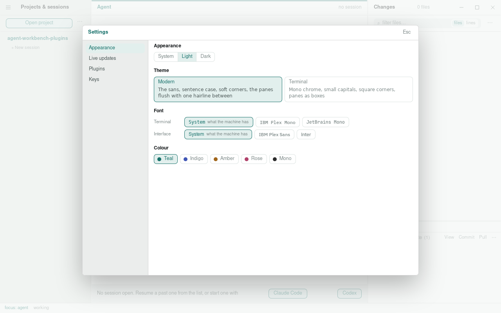

# Settings

Settings open from the native menu, or with <kbd>Cmd</kbd><kbd>,</kbd>
(<kbd>Ctrl</kbd> on Windows and Linux), over the workbench. A choice applies
at once.

The settings are in eight tabs down the left. Appearance carries the
appearance, theme, font, colour and custom styles sections; live updates,
sessions, workflows, accounts, plugins, keys and notifications each carry
the section of that name. Opening the settings again lands on the tab last used, for as long as
the window is open. The dialog follows the look the panes are drawn in. It
has one size for every tab, so nothing moves when the tab changes, and a tab
that needs less width keeps its content at the width it reads at.

## Appearance

System, light or dark. System follows the desktop and changes with it.

## Theme

Modern or terminal, modern to begin with. Modern sets the chrome in the
sans, in sentence case, with soft corners and the three panes flush on one
surface, a single hairline between each pair and the sessions pane a shade
below; that hairline is the resize bar itself, with three pixels either side
of it to take hold of, and it turns accent under the pointer. Terminal is mono
chrome, small capitals, square corners and panes drawn as boxes. The focused
pane is marked in the accent either way, its title with it: an edge along the
header under modern, the pane's own border under terminal. Both use the same
colours, so the appearance and the palette hold across either.

## Font

Two families, chosen apart: the one the terminal draws in and the one the
rest of the app is set in. Each starts on the machine's own, the monospace
and the sans the system draws with; the terminal can have IBM Plex Mono or
JetBrains Mono instead, and the interface IBM Plex Sans or Inter, all four
shipped with the app. Each name is shown in its own face. A change reaches
every open terminal at once, which measures its grid again and tells the
process the size it now has, so there is nothing to restart.

## Colour

Five palettes: teal, indigo, amber, rose and mono. Every colour in the app
comes from a small set of semantic tokens, ink, surface, rule, accent, add,
del, and a palette restates the accent and the cast of the greys for both
appearances while add and del stay what they are. The terminal's sixteen
ANSI colours are derived from the same tokens, so the agent's own interface
sits in the palette rather than beside it.

Themes of your own sit after the five. A theme restates some of those
tokens, for the light appearance and the dark, and may set a few measures of
the chrome's shape: the corner radii and the padding inside a pane. A token
it leaves out keeps the teal palette's value, and a colour it sets only for
light gives way to teal's dark value in the dark, so a theme never paints
the light ground into the dark appearance. Colours are taken only as hex and
measures only as whole pixels within a limit, so a theme can recolour and
reshape the window and do nothing else. A theme is chosen like a palette and
deleted with the cross beside it; deleting the one in use goes back to
teal. An agent can make one for you, as the next section describes, and the
file described under [where they are kept](#where-they-are-kept) holds them
for editing by hand.

## Custom styles

A stylesheet of your own, `user.css` beside the settings file, laid over
the app's own when this is on. It can restyle anything, and it can load
nothing: a sheet with an `@import`, a `url()` that is not a `data:` url, an
image function that takes an address, or a backslash escape, which could
spell one of those out of sight, is not used, and the section says why.
It is off to begin with, and turning it on is kept with the rest of the
settings.

The sheet is set aside while the settings are open and while the app asks
you something, such as whether an agent may start a session or change a
setting. A sheet can dress anything up, and a question has to read as the
app's own; the settings being plain is also the way back from a sheet that
has made the rest hard to use. Turn Off Custom Styles, in the app's menu on
macOS and in the menu at the top left elsewhere, turns it off from anywhere
by writing the settings file itself.

A sheet holds up best aimed at what stays put: each pane is a
`section[data-pane]`, named `sessions`, `agent`, `changes` and `terminal`,
with its header the first thing in it; the controls the tests reach for
carry a `data-testid`; and the colours, sizes and shapes the stylesheets
are written in are custom properties on the root, the ones a theme sets
among them. Class names are the app's own and change without notice.

## Live updates

Watcher only, or agent hooks, chosen once for every project; each project
you open follows it, and a project that should go the other way can say so
under it. A fresh install starts with the hooks on; a setup from before the
choice existed starts with them off, and is told once, in a word over the
agent pane, what turning them on gives; the word's link opens the settings
at this section. What each means for the changes pane and for a session's
row is in [sessions](sessions.md); what the hooks write and where, and the
tools they bring the agent, is in [hooks](hooks.md).

## Sessions

How long a past session stays listed under its project: forever, 30 days,
7 days or 1 day, forever to begin with. A session this app ran is listed
under its project, greyed, ready to resume, as [sessions](sessions.md#past-sessions)
describes. Left unchanged for longer than the span chosen, it goes behind
the fold with the rest of the project's history instead, where it is still
there to resume and to search; a row left from the last quit, with nothing
running behind it, goes the same way. Resuming one brings it back to the
list. Nothing is deleted: the transcripts are the agent's own and stay where
they are.

## Workflows

A workflow says which model a session starts on and which models it may hand
work and review to. It holds a name, the orchestrator's model, and steps in
order. The roles are fixed: the orchestrator is the session the user talks
to, a worker does a piece of work, and a reviewer checks it.

A model is an agent and a model name, since a model's name belongs to one
agent. Claude Code offers the aliases its command line takes, fable, opus,
sonnet and haiku. Codex offers one, called Codex, which means whatever Codex
runs by default. Only the agents found on the machine are offered, with any
a workflow already names so that its choice can still be shown.

A step has a name, a kind and the models it may use. The models are any, or
a chosen set across the agents, and the first one chosen is the one used
unless the orchestrator has a reason to pick another. A step that does work
says how many sessions may run at once, from one to eight. A step that
reviews says when the work passes: the reviewer approves, the orchestrator
agrees, or both, so at least one is on. Otherwise the work goes back to a
named earlier work step, never to another review, at most so many times,
from one to ten, and then the user is asked.

A workflow has from one to twelve steps and the first does work. A name is
a few words, forty characters at most, and is unique among the steps of a
workflow and among the workflows, of which there are sixteen at most, the
upper and lower case of a letter from A to Z counting as the same. A model is named in
one word of forty characters at most, and a step lists a model once and
sixteen at most. The window holds a change to the same rules the settings
file is kept by, so a change it shows is one that is kept.

A fresh install has one workflow, Build and review. Its orchestrator is on
Claude's most capable model alias, its Work step is on Sonnet, and its
Review step is on Opus, passes when the reviewer approves and the
orchestrator agrees, and goes back to Work up to three times before it asks.
A settings file from before workflows existed gets the same one.

A workflow in the file that does not read or keep the rules is not used, and
neither is a default or a project choice that names it. It is not dropped:
the tab names it, says the rule it breaks, and offers to remove it from the
file, and until then every write keeps it in the file as it was written,
with the default and the project choices that named it. Choosing another
default, or another workflow for such a project, takes the place of the one
in the file. Its name stays taken, so no other workflow can be given it and
then be read as the one the file's choices mean. A choice naming a workflow
the file does not hold at all is dropped.

One workflow is marked as the one new sessions start with, and none is a
valid choice. A project can choose another, or none, whatever the default
is. Deleting a workflow that was the default leaves new sessions with none,
and a project that chose it follows the default again.

The tab lists the workflows across the top, with the default tagged, and
New workflow after them. The picked one has its name above the diagram,
with Duplicate. The diagram draws the orchestrator as the frame, since it is
the session the user talks to, with its model in a menu on its head. Inside
sit the steps in order with an arrow between each, each showing its role
and its models. A plus on every arrow opens a menu to add a work step or a
review step there; the step added is picked and has the keyboard. A new
review is numbered after the reviews before it, Review 2 after Review, and
one added before a review already there is a Check, so no number reads out
of order. The
picked step has two arrows above it that move it earlier or later, as Alt
with the left or right arrow key does on the step. A review that goes back
draws a line under the row from itself to the step it repeats, lines that
arrive at one step standing side by side so they do not cross, and under all
the lines a label names the review and says where the work goes back to,
until when (the reviewer approves, the orchestrator agrees, or both approve)
and how many rounds at most. The steps share the width there is; where even
the narrowest steps do not fit, the row scrolls sideways under the
orchestrator's head, which stays in place, with the hidden edge faded, and
the step picked is scrolled into view.

The diagram stays at the top while the rest of the tab works around it.
Picking a step shows its settings beside the diagram where the window has
room for a workflow of four steps and the settings together, and under it
where it has not, whatever the number of steps; there they take two columns
where they have the width. They scroll on their own and the diagram does
not move. The settings read from top to bottom: the step's name, whether it
does work or reviews it, the models it may use with the first chosen marked,
and the settings of its kind, a review's ending in one sentence such as go
back to Work at most 3 times, then ask me. A model other than the first can
be made the one used first. Any model stays ticked until a model is chosen.
Removing a step, at the foot of its settings, asks first and says which
reviews would go back elsewhere. Renaming a step carries the reviews that go
back to it, and removing or moving one points a review that went back to it
at the nearest work step before the review.

A control the rules would always refuse is dimmed and does nothing, and says
why when the pointer rests on it and to a screen reader: moving a step past
the end, or where a review would come first; removing the only step, or one
whose review would then come first; and turning off the one way left for a
review to pass. A change whose refusal cannot be known before, such as a
name another step has, is said beside the control it came from until
another step is picked. A change the settings file refuses, when it cannot
be written, is said at the top of the tab, and the window shows what is
stored. Every control can be reached with the keyboard, and the two kinds
are a radio group the arrow keys move through.

Under the diagram, What the orchestrator is told unfolds into the
instructions the workflow comes to: a short numbered list. The first tells
the orchestrator to direct the work rather than do it, and to delegate by
starting sessions with the workbench's `start` tool, not with its own
subagents, giving the agent and the model each step names and no model for
Codex's own default. Then each step has a sentence naming the step, what a
piece has come out of or passed before it, the models it may use with the
first as the one to use, how many sessions may run at once, or for a review
when the work passes, where it goes back, which steps the piece is taken
through again before it is reviewed again, how many times, and that the
user is asked after that. The last sentence says to report to the user once
every piece has come out of or passed the last step.

The foot always shows. A switch there marks the workflow for new sessions, with a line
saying which workflow new sessions start with. Turning it off leaves them
with none. Delete workflow stands apart at the other end, drawn as
destructive, and asks first, saying what follows: new sessions starting with
none, or projects following the default again. After what the orchestrator
is told, Project choices lists each open project with a menu: as for new
sessions, no workflow, or one of the workflows. The choices are kept with
the settings, by project path.

## Accounts

An account is a login kept apart from the others. Claude Code keeps its
login, its settings and its past sessions in a configuration directory,
`~/.claude` unless `CLAUDE_CONFIG_DIR` names another; Codex keeps its own
in a home, `~/.codex` unless `CODEX_HOME` names another. An account names
a directory of each, so a work login and a personal one can both be on the
machine and a session run under either. The agents' own directories are
the account every setup has, called Default where a name is shown, and a
setup with no other account named is what it always was.

The tab lists the accounts, Default first, each with where it keeps each
agent. Add an account… opens a form: a name, and under it the two
directories the name suggests, `~/.claude-work` and `~/.codex-work` for an
account called Work, shown as they will be. A pencil beside either opens
it for editing, and a directory opened that way keeps what is typed into
it while the other goes on following the name. A directory left blank
means the agent's own, so an account can be for one agent alone. Nothing
exists until Add. Remove takes an account away; the projects that named
it follow the rest again.

Naming an account does not log anything in. The directory is empty until
the agent has been run with it once: in a terminal, with
`CLAUDE_CONFIG_DIR` or `CODEX_HOME` set to the directory, the agent asks
for a login the first time and keeps it there. Whatever of the agent's
global configuration the account should share, Claude Code's `CLAUDE.md`
and skills most of all, is copied or linked in by hand.

Under the list, Which account is chosen the way live updates are: one
account for every project, and a fold of project overrides where a project
can name an account of its own, or Default, whatever the rest. A session
runs under its project's account: it starts with the agent's directory set,
its past sessions are read from there, and the tools the hooks bring are
registered there too, as [hooks](hooks.md) describes. What a project's row
shows, and how one session can go another way, is in
[sessions](sessions.md#accounts).

On a remote project the directories are on the remote machine, spelled
with `~` for its home; the accounts themselves are kept with the settings
of the machine the window runs on.

## Plugins

Sources of plugins, each a git repository or a directory on this machine, with
the plugins each names, what each plugin is for and how it is faring, and a
switch per plugin. Check for updates, at the top, asks every fetched source at
once. The sources the workbench knows are listed from the first launch with
every plugin off, and turning one on fetches its source first. A source of
your own goes in behind Add a source, under them. What adding, enabling,
checking and updating do is in [plugins](plugins.md).

## Keys

The whole chord table, with two presets and room for your own. What the app
may claim and why is in [focus](focus-model.md).

## Notifications

Two switches for a session that starts waiting for you while the window is
in the background, as [sessions](sessions.md) describes. System
notifications are on to begin with: the system shows the project and the
session, and what it waits on. The chime is off to begin with: a short,
quiet tone, played once as it is turned on. Each is kept with the rest of
the settings.

## An agent changing them

An agent can read the settings and ask to change them, with two tools the
workbench offers it alongside the others in [hooks](hooks.md). They are for
when the user asks the agent for a change to the workbench itself, a darker
appearance or a chord of their own, and the agent is told so.

Reading answers at once, with every setting, what it takes, and the chord
of every action. A change names only what should change, and the agent may
give a reason in the user's terms. It is checked whole before the user
sees it: a value a setting does not take, an action that does not exist, a
chord two actions would share or one the agent's terminal needs, and the
agent is told why without the user being troubled. The agent hooks, the
plugins, the accounts, which workflow a project follows, how long past
sessions stay listed, the notifications and the chime are refused outright,
as the user's to change.

A change that will do is put to the user over the agent pane: who is
asking, the reason, and each setting from what it is to what it would be.
Nothing changes unless they allow it, and the agent waits for the answer,
which says which it was. A change the user allows can be undone, from a
word where the question was, for twenty seconds; undoing puts back only the
settings that change moved. Changes asked at once are put one after
another, each read against the settings as they are by the time it comes
up.

An agent can add a workflow, replace the one of the same name, delete one,
and name the workflow new sessions start with, or none. It reads the
workflows with the other settings, as they are stored, with what each
field takes. A workflow it writes is checked whole against the rules under
[workflows](#workflows) and read strictly, so a field the shape does not have
is refused. The user is shown the workflow as one line each from and to: the
orchestrator's model and then each step with its models, when a review
passes the work and its limits. The agent also reads the workflows the file
holds but cannot use, each with the rule it breaks and as it is written, and
writing a workflow under one's name mends it: it takes that one's place, with
the default and the project choices that named it. Deleting one also shows each project that
chose it and would follow the default again. The change is planned again
when the user allows it, against the workflows as they are by then, so
edits made in the settings meanwhile stay; if what it would do has changed
since it was shown, the user is asked again about what it now does. If it
cannot be kept the agent is told so and nothing changes. Undoing puts back what the change touched: the workflow
written as it was, or away if it was new, one deleted where it stood with
the projects that chose it, and the default.

An agent can also save a theme of the user's own, for a look the palettes
do not give, and switch to it in the same step. The theme is checked the
way the file is, and for being readable: the ink needs a contrast of 4.5 to
1 against the surface and the background in either appearance, and the
accent 3 to 1 against the surface, or the agent is told the ratio that fell
short. The user sees the theme as a small card on its ground for each
appearance before allowing it, and undoing takes the theme away again with
the palette it replaced.

An agent can write the stylesheet too, for a change the settings and a
theme cannot make. It replaces the sheet whole, is held to the same rules
before the user is troubled, and is shown to the user as the sheet itself;
allowing it writes it and turns custom styles on. Undo puts back the sheet
it replaced. The agent reads the sheet there with the other settings, and
is told to aim at the stable parts named in the section above.

The settings an agent changes are those of the machine the window runs
on, whichever machine the agent runs on.

## Where they are kept

The appearance, the look, the palette, the fonts, the chords, the answer
on hooks, the accounts, the workflows and the projects' choices among them,
how long past sessions stay listed, the
notifications and your own themes are kept for the machine, in `settings.json` under `~/.agent-workbench`, and every
window on the machine follows the same file.
The window reads it at start and hears of every change to it, whether made
in the settings, by another window, or by an edit to the file itself, which
reaches an open window at once. A value in the file that the app does not
know is passed over and the default stands for it, and a workflow that breaks
a rule is set aside as [workflows](#workflows) describes; neither makes the
file unreadable.

A read finds the file in one of three states: there is none, it is whole, or
it is there and is not a JSON object, because it is empty, cut short or not
settings at all. A file that is not there is the defaults, and the window
hands over the copy it keeps. A file that is not readable is not the defaults:
the window keeps the settings it has, hands nothing over, and takes the file
once a whole one is announced. A whole file is announced when it differs from
what was last announced, and also when the look before it found the file
unreadable, so the same content written again after the file was emptied
still reaches the window. The window's first read is passed over only when
it has already taken settings that are as new or newer, from news or from the
answer to a change of its own. News that arrives while a change of its own is
on its way is not taken, and does not count.

A change builds on the file as it is. If the file is not readable, the save
looks again a few times, forty milliseconds apart, since whatever writes a
file by emptying it first is usually done within moments. If the file is whole
by then, the change is laid over it. If it is still not readable, nothing is
written, the file is left as it is, and the change is refused with a reason
that says the file could not be read and where it is, so a hand edit under
way is never written over with the defaults. The window then shows the change
it made and keeps the reason, as for any change the file refuses.

The app writes the file whole: the text goes to a temporary file beside it,
is flushed to disk and is moved over the settings file, so anything reading
the file, the app's own watcher included, finds the old settings or the new.

The window keeps a copy of its own as well, so the first frame of a start is
painted as the last one was before the file has been read. On a machine
without the file, that copy is what the file is first written from.

The plugins keep their own record, described in [plugins](plugins.md). A
window on a remote machine's project still follows the settings of the
machine the window runs on.
